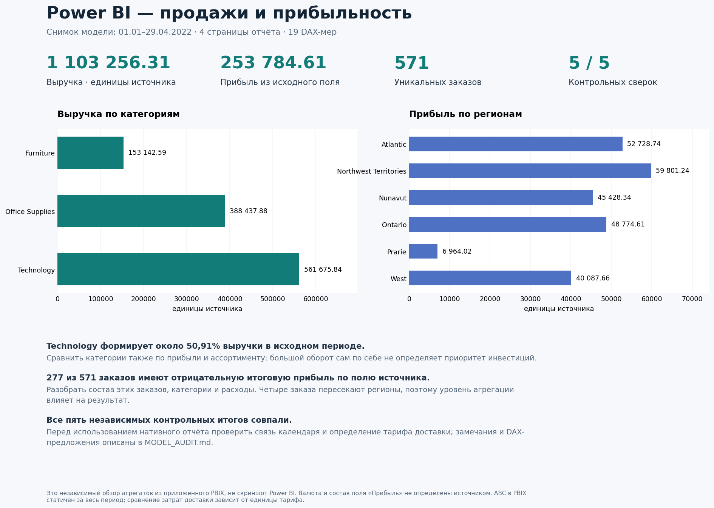

# Power BI — продажи, продукты и прибыльность

Учебный BI-кейс: **4 страницы отчёта, 19 DAX-мер, 730 строк продаж**.
Короткий обзор ниже рассчитан независимо из встроенной модели PBIX;
для его просмотра Power BI Desktop не требуется.

**Результат:** [скачать исходный PBIX](report/sales-analysis.pbix) ·
[интерактивный HTML — скачать и открыть](https://github.com/salaticc/powerbi-sales-analysis/raw/refs/heads/main/docs/index.html) ·
[аудит модели и необходимые исправления](MODEL_AUDIT.md).



## Что есть в отчёте

| Страница | Вопрос бизнеса |
|---|---|
| Обзор | Как меняются выручка, прибыль, средний чек и число покупателей? |
| Продукты и покупатели | Какие категории и сегменты формируют показатели? |
| ABC продуктов | Как распределён товарный вклад за весь исходный период? |
| Регионы | Где сосредоточены прибыль и отрицательные результаты? |

Период снимка: **01.01–29.04.2022**. Выручка — **1 103 256,31**,
прибыль из исходного поля — **253 784,61**, **571 заказ**, **173 покупателя**.
Валюта источником не определена, поэтому ₽/$ не подставлены.

Все **5 контрольных итогов** встроенной таблицы совпали с независимым Python-пересчётом.
Границы поля «Прибыль» и тарифа доставки требуют бизнес-определения.

## Качество и статус

Исходный PBIX добавлен без скрытой модификации бинарной модели.
Аудит выявил отсутствие связи календаря и продаж, а также неоднозначный
уровень меры убыточных заказов. Исправленные DAX-определения и шаги проверки
подготовлены в [model/corrections.dax](model/corrections.dax) и [MODEL_AUDIT.md](MODEL_AUDIT.md).
Они **ещё не применены в Power BI Desktop**; веб-обзор показывает пересчитанный снимок,
не имитирует работу исправленного нативного среза даты.

## Воспроизвести сверку

```bash
git clone https://github.com/salaticc/powerbi-sales-analysis.git
cd powerbi-sales-analysis
python -m venv .venv
# Активируйте окружение вашей ОС
python -m pip install -r requirements.txt
python -m scripts.build_report
```

Скрипт извлекает модель через PBIXRay, пересчитывает итоги, формирует HTML,
PNG, агрегаты и [summary.json](reports/summary.json) с SHA256 исходного файла.
Пересчёт DAX движком Power BI и проверка нативного отображения не выдаются за выполненные.

## Материалы для технического просмотра

- [Извлечённые меры](model/measures.json), [связи](model/relationships.json), [схема](model/schema.json).
- [Пять сверок](reports/control_reconciliation.csv), [категории](reports/categories.csv), [регионы](reports/regions.csv).
- [Изменения](CHANGELOG.md).

Набор используется как учебный кейс; коммерческий рост выручки от этого отчёта не заявляется.
